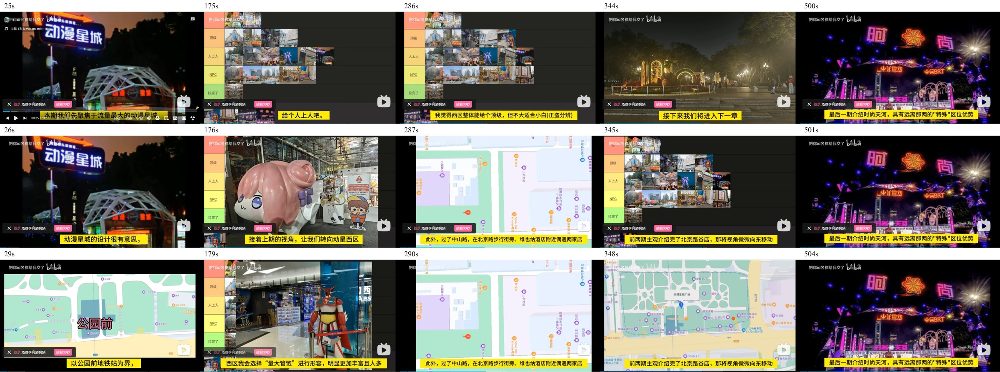
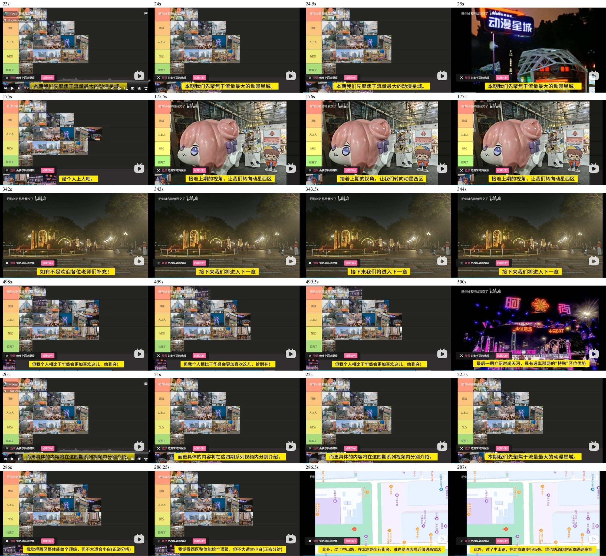

# BV1EFfJBwEjh 广州商圈视频引用核查

读取及核查日期：2026-10-20。视频真实标题：**沪人主观横评妖都广州三大二次元商圈对比从夯到拉**。公开页面显示发表于2026-02-21 21:20（北京时间），仅P1，CID `36191209034`，时长678秒（11:18）。本轮只补视频引用，沿用现有5个地点ID、共享组件和介绍后的入口；不把视频内容用作2026-10-20当前店铺营业确认，不改店单来源或核对日。

来源：[原视频](https://www.bilibili.com/video/BV1EFfJBwEjh/)、[公开视频元数据](https://api.bilibili.com/x/web-interface/view?bvid=BV1EFfJBwEjh)、[公开章节 view_points](https://api.bilibili.com/x/player/v2?bvid=BV1EFfJBwEjh&cid=36191209034)。仅保留必要元数据，不保存接口中的封面／章节图片地址，不下载视频文件，不读取私人Cookie。播放器和原站查看时正常请求的画面不作为本网站封面。

## 作者章节与逐点匹配

真实章节静态保存在 [生产配置](../../../rank/src/data/bilibili-videos.json)，视频仅保存一份，商圈通过 `videoId` 引用。章节名称与原始时间不改写。

| 章节 | 原始起止 | 对应地点 | 接入起点 | 结果与依据 |
| --- | --- | --- | --- | --- |
| 引言 | 00:00–00:26 | 无单独入口 | — | 不给商圈套用整段视频起点 |
| 动漫星城（东） | 00:26–02:56 | `guangzhou-shop-003` 动漫星城（东区） | 00:22 | 22秒仍是系列说明，22.5秒开始聚焦动漫星城的完整开句，25秒切外观；26秒已在介绍设计，29秒转入公园前东西分区说明。保留共同引入，随后对应东区介绍 |
| 动漫星城（西） | 02:56–04:47 | `guangzhou-shop-002` 动漫星城（西区） | 02:55 | 175秒为东区总结，175.5秒转西区现场并开始转向西区的开句；179秒介绍星大馆 |
| 北京路个人发现的小店 | 04:47–05:45 | `guangzhou-shop-005` 北京路谷店 | 04:46 | 286.25秒仍为西区总结，286.5秒切北京路地图并开始过中山路、北京路步行街旁小店的完整路线引入。与网站记录的点状小店范围一致 |
| 地王广场 | 05:45–08:21 | `guangzhou-shop-001` 地王广场 | 05:42 | 342秒是北京路结束语，343秒开始进入下一章的转场；345秒续接向东移动的路线开句，348秒地图定位地王广场。保留必要转场与完整路线引入 |
| 时尚天河 | 08:21–11:18 | `guangzhou-shop-004` 时尚天河 | 08:19 | 499.5秒仍为地王总结，500秒切时尚天河入口并开始介绍其区位；保留外景及完整开句 |

上述起点均独立查看了浏览器实际视频画面与画内字幕（`method: video-frames`），不是按章节名称估算，也不声称连续听辨全部音轨。核查秒数与逐项依据保存在对应 `clips`；所有起点早于章节标记的记录均填写 `chapterOverlapNote`。句界或转场发生在一秒内部时，起点向前保留整数秒，可含不足1秒的前段；地王同时保留必要转场。北京路不混入西区，东、西区分别接入；没有新增地点或店铺卡片入口，无待解决匹配歧义。

## 验收

2026-10-20验收结果：

- 数据校验通过：29个既有地点、38条更新。52项单元测试全部通过，包含广州5个独立引用点、东西区与北京路番外的对应关系、章节原始时间和完整引入例外。
- 构建通过：按项目构建脚本顺序完成数据校验、媒体准备、TypeScript检查及Vite生产构建。当前终端无 `npm` 可执行文件，实际使用Node直接运行对应入口，没有省略构建步骤。
- 新增广州专项浏览器检查通过（1项，覆盖1440px和390px下的5个地点、共10组场景）：入口紧随商圈介绍，店铺卡片无重复入口；带视频时间参数直达与刷新均不创建iframe、不发起B站请求；外链包含正确视频、P1和逐点时间；键盘明确加载后创建正确 `autoplay=0` 的iframe，权限仅fullscreen；关闭移除，刷新不恢复，无横向溢出。该自动化检查拦截播放器请求，只证明本站生命周期，不作为真实播放依据。
- 真实Edge桌面播放器单独实测东区入口：加载前iframe为0；明确加载后地址为 `https://player.bilibili.com/player.html?bvid=BV1EFfJBwEjh&autoplay=0&p=1&t=22`，实际video.currentTime为22、paused=true、autoplay=false、readyState=4、duration=678。点击播放器内播放按钮后实际时间推进至23.461121秒、paused=false；暂停后关闭，iframe恢复为0。其余4项已核查原站视频画面和本站定位参数，未逐项在嵌入播放器点击播放；真实手机设备及iOS Safari未实测。
- 差异核对确认店单数据完全未改，地点仅同步5处 `updatedAt`；作者评级、排序、正文、到访日、图集和店铺核对日均保留。原上海视频及17处引用完整保留。报告本地链接和差异格式检查通过。
- 临时配置与过程截图已清理，仅保留下方两张有独立定位信息的联系表；未提交、推送或发布。

## 独有画面证据

仅保留两张联系表：第一张覆盖5个章节附近画面，第二张汇总开句与半秒边界复查。它们用于维护定位，不进入前台图集或封面。

尚未提交、推送或发布。
