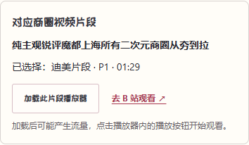
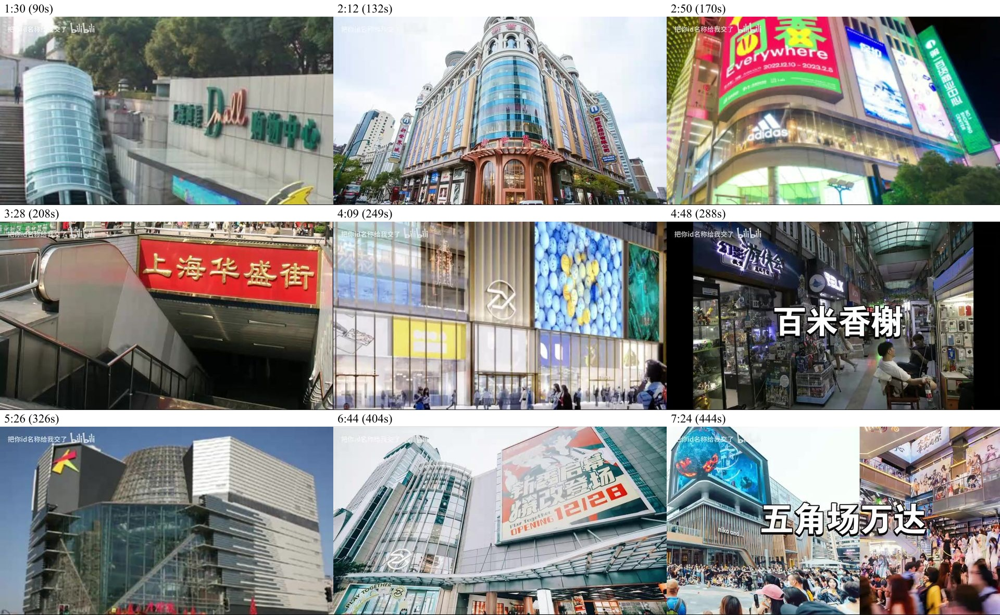
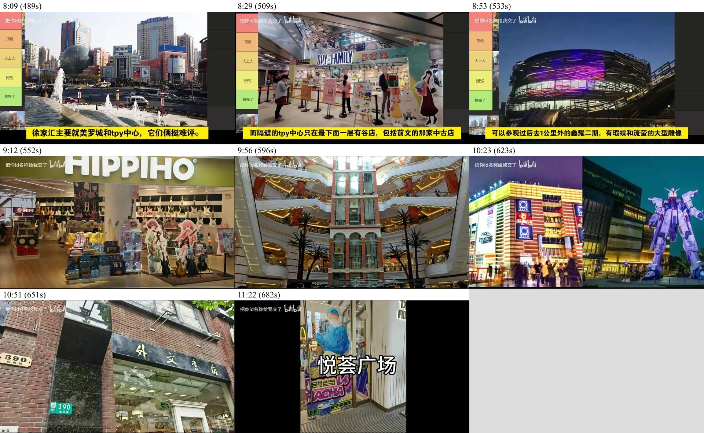
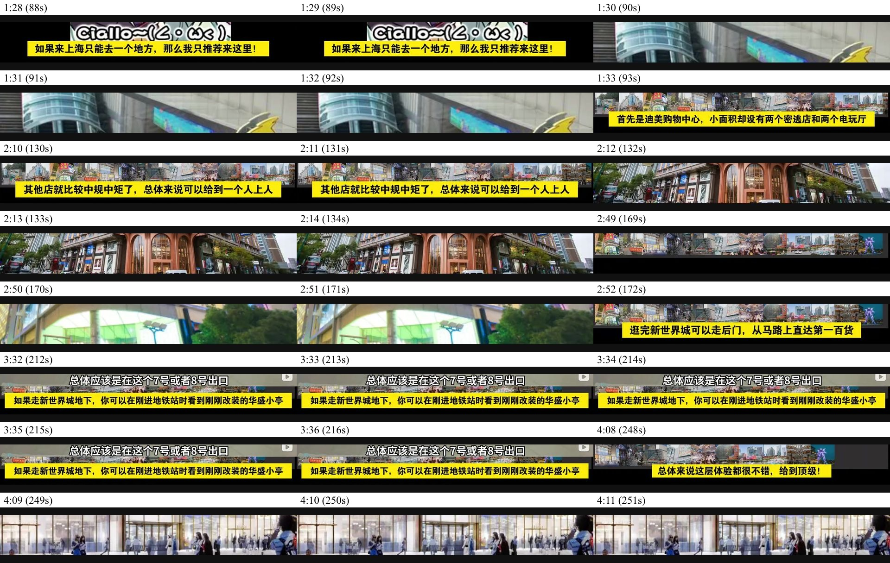
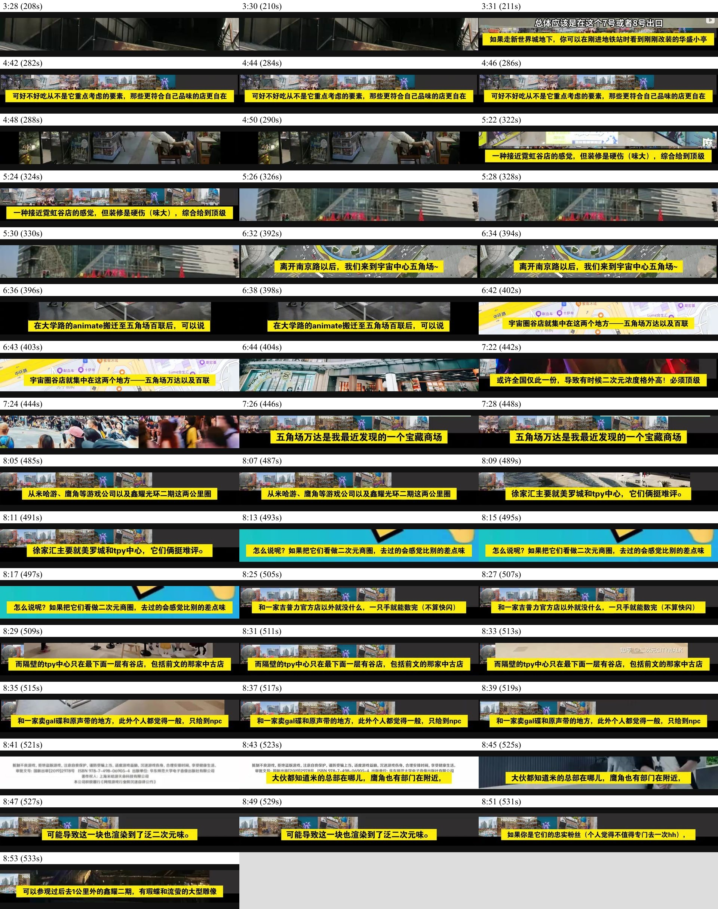
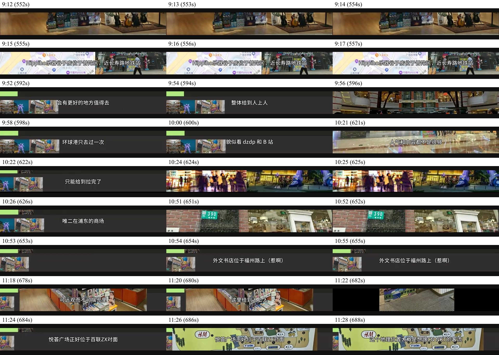
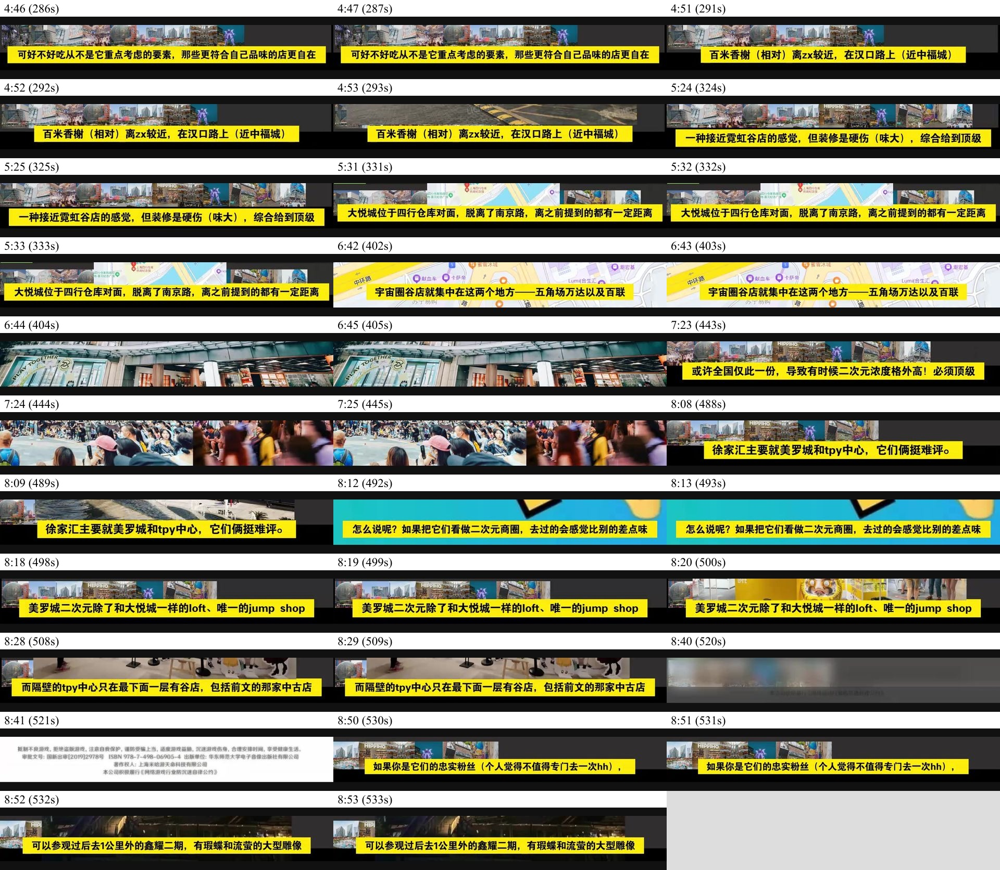
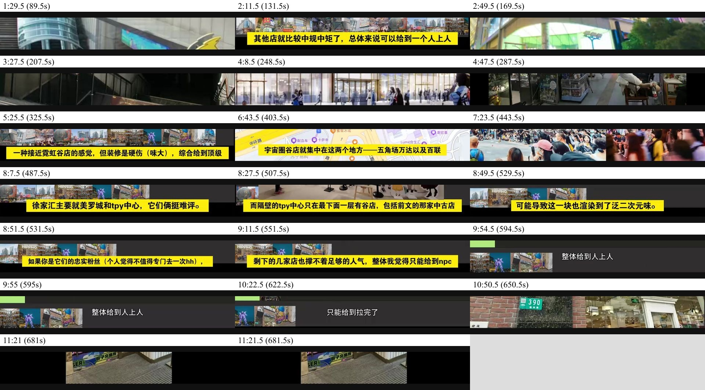
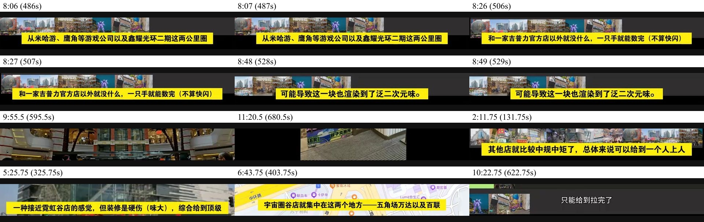

# BV1uUWizfEvv 商圈片段接入核查

核查日期：2026-10-17。视频真实标题：**纯主观锐评魔都上海所有二次元商圈从夯到拉**。BV：`BV1uUWizfEvv`；仅 P1，时长 735 秒（12:15）。元数据与章节已在维护阶段读取并静态保存，访客不调用 B 站接口。未使用、请求或保存视频封面，未保存完整视频，未读取私人 Cookie。

来源：[原视频](https://www.bilibili.com/video/BV1uUWizfEvv/)、[公开标题与分 P 元数据](https://api.bilibili.com/x/web-interface/view?bvid=BV1uUWizfEvv)、[公开章节 view_points](https://api.bilibili.com/x/player/v2?bvid=BV1uUWizfEvv&cid=33131596631)、[外链播放器官方参数](https://player.bilibili.com/)。合集中的其他视频不是本视频的分 P。

## 定位方式与精度

17 项均直接查看了公开原始媒体流按指定时间解码的视频帧和画内字幕（`method: video-frames`）。这属于画面核查，不是仅靠章节名称、搜索摘要或估算，也不是完整连续观看并听辨音轨。浏览器中文字幕曾用于辅助缩小范围，但最终以原始视频帧复查。每项 `evidenceFrames` 记录实际检查的秒数，下面保留主要联系表；图内标签为取帧时间，半秒标签中的小数仍是秒。

入口时间是精确的整数秒 `t`。转场或开句在一秒内部发生时，为保留完整开头而向前取整，最多包含不足 1 秒的上一画面；不声称句界天然对齐整秒。片段保留正式介绍前的外观、标题卡、路线转折或条件引入，不使用预告、首次一闪而过的提及或总结作定位依据。

章节标记有小幅滞后：第一百货、南京路百联、五角场百联、金桥 LaLaport 的外观引入略早于标记；美罗城的正式共同引入比标记早约 11 秒。这些项均记录 `chapterOverlapNote`，没有悄悄回退到章节开头。

## 真实章节（均为 P1）

| 章节 ID | 原始章节名称 | 章节起点 | 查找范围（秒，结束不含） |
| --- | --- | --- | --- |
| p1-0 | 引言 | 00:00 | 0–38 |
| p1-38 | 区域划分 | 00:38 | 38–89 |
| p1-89 | 迪美+新世界城 | 01:29 | 89–170 |
| p1-170 | 第一百货+华盛小亭 | 02:50 | 170–250 |
| p1-250 | 南京路百联+百米香榭+静安大悦城 | 04:10 | 250–404 |
| p1-404 | 五角场百联+五角场万达 | 06:44 | 404–498 |
| p1-498 | 美罗城+TPY+米角+鑫耀二期 | 08:18 | 498–551 |
| p1-551 | 普陀HIPPIHO+环球港 | 09:11 | 551–623 |
| p1-623 | 浦东lalaport+正大广场 | 10:23 | 623–650 |
| p1-650 | 外文书店+悦荟广场 | 10:50 | 650–734 |

## 逐商圈接入

统一位置：`rank/guide/#/place/<稳定 ID>` 的“商圈介绍”（含已有探访建议）区块之后、谷店一览或图集之前；兼容图片总榜的 `rank/#/place/<稳定 ID>` 详情路由。由 `PlaceDetail.vue` 渲染一次，不出现在其下属店铺卡片。

所有下列条目状态均为 **配置完成／画面定位已核查**，无待确认匹配；播放器逐项手动播放的验证范围另见后文。视频统一引用 `shanghai-ranking-bv1uuwizfevv`，不复制完整视频元数据。

| 商圈（稳定 ID） | 所属章节 | P / 入口时间 | 定位依据 | 复查链接 |
| --- | --- | --- | --- | --- |
| 迪美（`shanghai-shop-007`） | 迪美+新世界城 | P1 / 01:29（89 秒） | 迪美购物中心外观在89.5秒已出现，随后画内字幕以“首先是迪美购物中心”展开介绍；保留外观引入。 | [查看该时间](https://www.bilibili.com/video/BV1uUWizfEvv/?p=1&t=89) |
| 新世界城（`shanghai-shop-003`） | 迪美+新世界城 | P1 / 02:11（131 秒） | 131.75秒仍为迪美总结，132秒切新世界城外观，随后字幕介绍本城四楼谷子店；从转场前的整数秒保留完整开头。 | [查看该时间](https://www.bilibili.com/video/BV1uUWizfEvv/?p=1&t=131) |
| 第一百货（`shanghai-shop-001`） | 第一百货+华盛小亭 | P1 / 02:49（169 秒） | 169秒仍为前段榜单，169.5秒切第一百货外观，172秒字幕以“逛完新世界城可以走后门”开始路线引入。 | [查看该时间](https://www.bilibili.com/video/BV1uUWizfEvv/?p=1&t=169) |
| 华盛小亭（`shanghai-shop-004`） | 第一百货+华盛小亭 | P1 / 03:27（207 秒） | 207秒仍为第一百货总结，207.5秒切“上海华盛街”入口，211秒字幕从走新世界城地下、刚进地铁站介绍华盛小亭；上海地点及后文别名一致。 | [查看该时间](https://www.bilibili.com/video/BV1uUWizfEvv/?p=1&t=207) |
| 南京路百联（`shanghai-shop-002`） | 南京路百联+百米香榭+静安大悦城 | P1 / 04:08（248 秒） | 248秒仍为华盛小亭总结，248.5秒切百联ZX外观，252秒字幕开始“无需多言的夯，上海SKP”；ZX与网站南京路百联对应。 | [查看该时间](https://www.bilibili.com/video/BV1uUWizfEvv/?p=1&t=248) |
| 百米香榭（`shanghai-shop-005`） | 南京路百联+百米香榭+静安大悦城 | P1 / 04:47（287 秒） | 287秒仍为百联ZX尾句，287.5秒切百米香榭标题及通道，291秒字幕介绍其在汉口路、近中福城的位置。 | [查看该时间](https://www.bilibili.com/video/BV1uUWizfEvv/?p=1&t=287) |
| 静安大悦城（`shanghai-shop-008`） | 南京路百联+百米香榭+静安大悦城 | P1 / 05:25（325 秒） | 325.5秒仍为香榭榜单，325.75秒开始切大悦城外观，331秒字幕介绍其位于四行仓库对面；保留外观开头。 | [查看该时间](https://www.bilibili.com/video/BV1uUWizfEvv/?p=1&t=325) |
| 五角场百联（`shanghai-shop-006`） | 五角场百联+五角场万达 | P1 / 06:43（403 秒） | 403.75秒仍为五角场区域地图，404秒切五角场百联ZX外观，后文开始与南京路百联比较；选择本商圈外观引入，不复用整段区域概述。 | [查看该时间](https://www.bilibili.com/video/BV1uUWizfEvv/?p=1&t=403) |
| 五角场万达广场（`shanghai-shop-009`） | 五角场百联+五角场万达 | P1 / 07:23（443 秒） | 443秒仍为五角场百联总结，443.5秒切“五角场万达”标题，446秒字幕开始“我最近发现的一个宝藏商场”。 | [查看该时间](https://www.bilibili.com/video/BV1uUWizfEvv/?p=1&t=443) |
| 美罗城（`shanghai-shop-015`） | 美罗城+TPY+米角+鑫耀二期 | P1 / 08:07（487 秒） | 487秒仍为徐汇两公里圈概述，487.5秒字幕正式转入“徐家汇主要就美罗城和tpy中心，它们俩挺难评”；保留共同引入及其后评价，498秒已是美罗城具体店铺清单。 | [查看该时间](https://www.bilibili.com/video/BV1uUWizfEvv/?p=1&t=487) |
| TPY中心（`shanghai-shop-012`） | 美罗城+TPY+米角+鑫耀二期 | P1 / 08:27（507 秒） | 507秒仍为美罗城尾句，507.5秒画面与字幕转为“而隔壁的tpy中心只在最下面一层有谷店”，介绍开始；保留完整转折句。 | [查看该时间](https://www.bilibili.com/video/BV1uUWizfEvv/?p=1&t=507) |
| 鑫耀光环live二期（`shanghai-shop-013`） | 美罗城+TPY+米角+鑫耀二期 | P1 / 08:49（529 秒） | 529秒仍在游戏公司周边概述，530秒起“如果你是它们的忠实粉丝”是下一句的条件引入，532秒字幕接“可以参观过后去1公里外的鑫耀二期”，画面与网站夜景、雕像语境对应。 | [查看该时间](https://www.bilibili.com/video/BV1uUWizfEvv/?p=1&t=529) |
| 少女乐队乐器店（`shanghai-shop-021`） | 普陀HIPPIHO+环球港 | P1 / 09:11（551 秒） | 551.5秒仍为鑫耀总结，552秒切HIPPIHO招牌及吉他墙，555秒字幕介绍其在普陀区、近长寿路；网站“少女乐队乐器店”正文和图集明确以HIPPIHO为代表，只引用这个代表案例。 | [查看该时间](https://www.bilibili.com/video/BV1uUWizfEvv/?p=1&t=551) |
| 环球港（`shanghai-shop-018`） | 普陀HIPPIHO+环球港 | P1 / 09:55（595 秒） | 595秒仍为HIPPIHO总结，595.5秒切环球港中庭，598秒字幕以“环球港只去过一次”开始正式评价；保留中庭引入。 | [查看该时间](https://www.bilibili.com/video/BV1uUWizfEvv/?p=1&t=595) |
| 金桥LaLaport（`shanghai-shop-014`） | 浦东lalaport+正大广场 | P1 / 10:22（622 秒） | 622.75秒仍为环球港总结，623秒切正大广场与自由高达的并列引入图，随后在浦东语境介绍两商场；金桥LaLaport由自由高达画面与后文高达特色唯一对应，保留完整共同引入。 | [查看该时间](https://www.bilibili.com/video/BV1uUWizfEvv/?p=1&t=622) |
| 外文书店（`shanghai-shop-010`） | 外文书店+悦荟广场 | P1 / 10:50（650 秒） | 650秒仍为浦东段结论，650.5秒切福州路390号外文书店门头，654秒字幕明确“外文书店位于福州路上”；保留门头引入。 | [查看该时间](https://www.bilibili.com/video/BV1uUWizfEvv/?p=1&t=650) |
| 悦荟广场（`shanghai-shop-011`） | 外文书店+悦荟广场 | P1 / 11:20（680 秒） | 680秒仍为外文书店结论，680.5秒切悦荟广场门店画面，682秒显示“悦荟广场”标题，684秒字幕介绍其在百联ZX对面；保留外景引入。 | [查看该时间](https://www.bilibili.com/video/BV1uUWizfEvv/?p=1&t=680) |

## 匹配边界与未接入项

- 南京路百联与视频中的百联 ZX，按南京路、ZX 门头及上下文匹配；五角场百联使用独立片段，未混为同店。
- 华盛小亭在视频外景中出现“上海华盛街”，后续字幕明确华盛小亭及新世界城地下路线，城市与上下文对应。
- “鑫耀二期”对应网站“鑫耀光环live二期”，夜景与游戏雕像介绍对应已有商圈资料；保留“如果你是它们的忠实粉丝”的完整条件引入。
- HIPPIHO 对应网站“少女乐队乐器店”的代表案例，正文及图集已明确同一品牌；入口不表示这个视频覆盖此类别下所有乐器店。
- 金桥 LaLaport 使用包含它与正大广场的完整共同引入；自由高达与浦东语境唯一对应网站地点。正大广场未在网站独立收录，故未新增地点。
- “米角”属于周边游戏公司语境，网站未独立收录，不新增入口。
- 网站的长宁龙之梦、长宁巴黎春天、悦沢书店、南方百联lab在本视频未找到独立正式介绍，不借用其他商圈或其他视频的时间；广州、苏州不属于本视频范围。
- 没有未解决的匹配歧义或章节读取失败；公开视频接口字幕列表提示需登录，未绕过，采用原始视频帧及画内字幕完成定位。

## 交互与验证记录

- 数据校验通过，29 个原有地点、21 条原有更新记录均保留；店单数据、来源、营业分类、checkedAt 未改。
- `npm test`：48 项通过，包含真实配置、重复引用、非法 BV／时间／章节、完整引入例外、无章节／读取失败区分、待确认状态与 P2 相对时间校验。
- `npm run build`：通过（包含数据校验、媒体准备、TypeScript 与 Vite 构建）。
- 浏览器自动化：最终 3 项通过（31.7 秒）。逐一检查 17 处入口都紧随商圈介绍、未放入店铺卡片；首次进入、打开详情、仅选片段及带视频时间参数的 URL 不创建 iframe、不发起 B 站请求；明确加载后只有一个 iframe，包含正确 bvid/p/t 与 autoplay=0，不授予 autoplay 权限；更换待选片段不改写旧 iframe，显式加载才替换；关闭、关闭介绍、切换商圈会移除播放器，重新进入不恢复。1440／390／320 像素宽度无横向溢出，键盘加载可用。已有店单总数、闭店分类、营业中来源隐藏、默认折叠、展开后的原始来源链接均检查通过。
- 自动化中的播放器生命周期测试拦截第三方请求，不作为真实 B 站播放成功的证据；多片段、P2、非法与待确认配置仅注入隔离测试页面，不进入公开配置。本环境默认测试服务器的自动清理曾挂起，最终使用独立启动的本地预览／fixture 和临时无 webServer 配置运行同一测试文件通过；临时配置已清理。
- 真实 Edge 桌面播放器实测：迪美入口加载前 iframe 为 0；明确点击加载后，URL 为 bvid=BV1uUWizfEvv&p=1&t=89&autoplay=0，播放器 video.currentTime=89、paused=true、autoplay=false、readyState=4。随后只通过播放器内播放按钮开始播放，时间由 89.19 秒推进；暂停时为 113.11 秒。点击“关闭播放器”后 iframe 为 0。
- 其余 16 项通过原始画面定位与页面配置检查，未逐项在真实第三方播放器中点击播放；实际手机设备与 iOS Safari 未实测。窄屏验收与真实手机播放应分别理解。
- 本地预览的现有百度地图曾弹出域名白名单提示，关闭后不影响视频入口；本次未修改地图功能。

## 主要原始视频帧联系表（仅维护证据，不作为页面封面）

## 后续维护

在 `rank/src/data/bilibili-videos.json` 中保留该视频唯一的 videos 元数据；更新对应 clips 的稳定 ID、chapterId、page、startSeconds、method、evidence、checkedAt、reviewUrl 即可。证据不足时改为 pending 并删除 startSeconds 与 reviewUrl，不发布猜测的时间。新增另一个视频时增加 videos 记录，商圈通过 videoId 引用，组件会提供片段选择。不要在店单中复制此入口。

没有提交、推送或发布。
