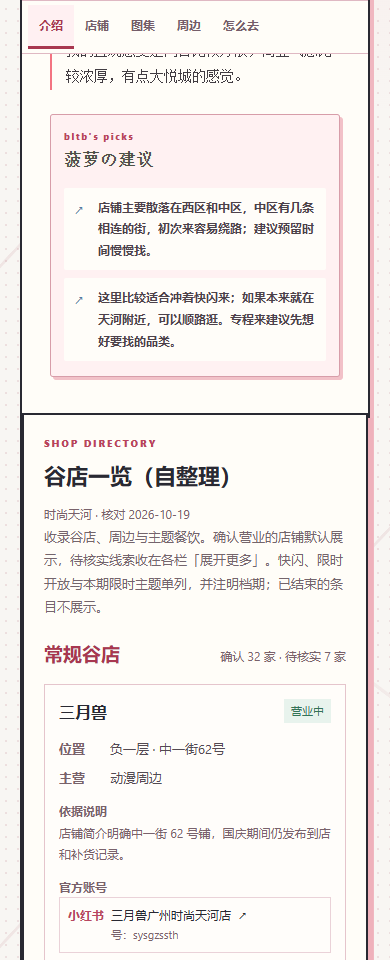
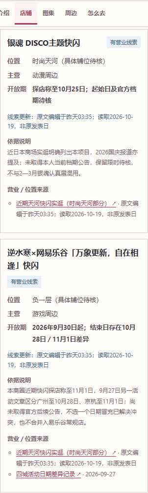

# 广州时尚天河复核（2026-10-19）

本轮已更新本地店单，未提交、推送或发布。稳定地点 ID 为 `guangzhou-shop-004`。当前为 **32条常规确认、5条限时确认、7条常规待核、2条限时待核，5条关闭记录隐藏**，前台合计46条记录。待核中有旧名、主体及重复关系未解决的线索，46条不等于已经确认46家独立实体店。

这是**阶段性结果**。双平台初始发现、官方来源和新增候选核对已执行，最后东区补漏未取得新的可归属本商场独立门店；但小小谷努咪原帖、梦幻潮玩目录仍无法实际读取，西区咖啡身份与部分当前主题档期仍有缺口。未宣称全商场无遗漏。网站验收通过只代表已接入内容可正常展示。

## 本轮范围与复用方式

按2025—2026资料窗口、用户的省年日期解释及限时分栏规则复核中区、西区、东区相关线索。保留作者2026-01-19到访、评级、排序、评价、建议和坐标，不根据第三方经营变化改写作者体验。

用户在本轮明确补充：**原网页已经记录的，只检查是不是对应，不用再搜一遍。** 此后没有重跑原名单，沿用已核对的原始来源、账号和读取日；只对新增候选及冲突补核。之前已执行的搜索保留为历史，不为展示进度重复执行。三月兽、COMIPLUS+、谷物集、千格谷、扭扭城、MYDreamWorld沿用2026-10-05已读本分店证据；批次核对日不冒充每篇帖子重新读取日。原摘录缺发表标签的，明确保留缺失，不补造日期。

樱漫全国门店导航虽最初在动漫星城研究中读取，正文也明确列时尚天河中二街102–109，故复用以确认本分店；品牌号仍标品牌号。GOODSLOVE的本店发售名单、潮玩星球的本分店上新和当前主题目录分别使用，不把其他分店经营套进来。原三月兽苏州品类来源、潮玩星球地王品类来源及其他旧字段完整留在[修改前快照](before.json)，生产品类改用本店依据或收窄，不删除研究档案。

## 数量与账号

| 分组 | 当前数量 | 展示方式 |
| --- | ---: | --- |
| 常规确认 | 32 | 默认显示 |
| 限时确认 | 5 | 单列限时栏，默认显示 |
| 常规待核 | 7 | 本栏默认折叠 |
| 限时待核 | 2 | 限时栏默认折叠 |
| 关闭／已公布关闭 | 5 | 不进入前台或展开数量 |

共有37条营业确认，其中31条挂有已核对账号，31个不同入口；包括5个品牌／共用号入口。另6条通过官方本店名单、商场公告或主题目录确认。关闭记录中的账号另列，未计入现行账号数量。店名、账号名称、号码、主页及范围以[生产店单](../../../rank/src/data/shop-directories.json)为准，研究依据见[evidence.json](evidence.json)。候选发现、营业确认、账号条目和入口数分别记录，不计算未知总数下的覆盖率。

## 关键变更

原名单新增确认包括萌谷子、GOODSLOVE、JOYOUTH、非人哉、B谷、漫库、暴蒙、TOY-C、饭沫宇宙、易乐谷、潮玩星球和樱漫；对应依据见[逐条证据](evidence.json)。本人持续上新与本分店地址匹配后停止重复追找，不将账号名本身当营业依据。

新增常规确认包括極樂一番Goods、谷艺人、模玩熊、森罗万象，以及后续核对的TOP TOY、追星馆、卡游、泽山谷町、谷惑崽、谷子快跑、魔渊、甜物嗒嗒、JoJoFun、弹了个猪。K-pop、娃店、潮玩与弹珠兼周边店按实际品类说明，未把它们全部写成动漫专营。

| 对应问题 | 本轮处理 |
| --- | --- |
| 暴萌 | 对齐本人“暴蒙 BOOMCOMIC”，旧名保留别名；使用时尚天河分店号 |
| 捣鼓社／嘀谷社 | 对齐本人及作者门头“捣谷社 DGS”；保留别名、纠正图注，关闭公告优先 |
| 易乐谷位置 | 使用本人易乐谷中三街082–088，纠正旧中二街；品类不限网易游戏IP |
| TOYC、TOP TOY | 两家不同店：TOY-C中二街055，TOP TOY中五街071，分别记录 |
| 泽山谷町 | 采用本人“天河南→时尚天河当前版本”和中三街46，不套旧址 |
| 谷艺人、gugugugu | 未证明同一店，会员宣传不足以合并；gugugugu同名空号不接入 |
| 潮玩星球零售与餐厅 | 中二街095–99a为零售；西一街060为本期犬夜叉餐厅，分开 |
| GOODS咖啡、Maid Jump、GOODSLOVE CAFE | 中一街039的GOODSLOVE主题有本人公告；旧西区泛称和作者Goods Cafe照片身份仍待核，未强行合并或另增Maid Jump计数 |
| 甜物嗒嗒铺号 | 本人原文“0960-100”有疑点，生产仅写中二街；不擅改或据相似铺号合并梦幻潮玩 |

## 关闭与主题期间

| 隐藏记录 | 依据与日期判断 |
| --- | --- |
| 南漫社 | 本人公告最后营业日2026-10-07，10-08正式闭店；2027回归只是计划 |
| 乌丸屋 | 2025-12-16本店顾客关闭正文，与实际查看的本人当前全国门店目录交叉；广州目录仅列动漫星城，未取得本店复业 |
| 趣玩+ | 本人明确2026-03-22正式关闭；旧主页营业介绍不能覆盖公告 |
| 捣谷社 DGS | 已公告2026-11-01营业结束后正式关闭；截至研究日尚未到最后营业日，按“已公布闭店”规则隐藏，不称已经撤店 |
| 谷丘社 | 本人2025年11月编辑的公告写“将于12.8闭店”，结合同期评论为2025-12-08；不是2026年 |

| 限时确认 | 范围与当前期间 |
| --- | --- |
| 潮玩星球咖啡·犬夜叉 | 本期主题，2026-09-25—11-29；官方主题店目录确认 |
| 木木来电·某某第三期下半场 | 本期主题，2026-10-01—11-21；木灵动漫本人公告确认 |
| GOODSLOVE CAFE·时光代理人社团大作战 | 本期主题，2026-10-16—12-13；品牌本人明确中一街039 |
| 微博×如鸢 | 快闪，2026-09-25—10-25；采用商场最新延期公告，覆盖原10-18 |
| 鸣潮×GLOBAL WORK积羽空明 | 快闪，2026-10-01起；官方正文未给结束日，探店称10-25仅保留待核。10-01—07是首周预约范围，不能当整期 |

银魂DISCO与逆水寒×网易乐谷分别保留限时待核。银魂起始日及官方结束日未取得；逆水寒探店称11-01，另一活动文章区分广州10-28、京杭11-01，未选择一个冒充已解决冲突。它们不与普通零售店合并。

次元波板糖的2026年斩神II（07-10—07-31）和忘川风华录广州主题（08-05—08-31）均结束，仅归档；广州档期不套上海结束日。保留常设店泛称的待核线索，不推断整店闭店。GOODSLOVE商品上新满赠、甜物嗒嗒周年店庆、饭沫生日气模、每日时段、排班、普通优惠均不据此判整店限时。

日期原标签及推断理由见[逐条证据与日期判断](evidence.json)：月日按原读取当年解释；相对日期原样保留；“编辑于”不变成原发表日；TOY-C标题10.19是上新日，原发表标签仍保留“昨天23:03”。

## 发现记录、停止条件与具体缺口

实际查询、模式、读取范围与失败记录见[discovery.json](discovery.json)。小红书、抖音均实际执行商场内容发现；抖音西区补查已读结果，东区操作超时未取得新结果，不能写成“已搜无结果”。后续小红书东区内容补漏已执行，正文为正佳广场6F的东映店排除。仅出现在关联搜索的异店作者不能直接生成本商场分店。

小红书一度要求APP扫码验证，用户自行验证后继续补齐TOY-C及新增主体；原失败记录保留。小小谷努咪商场帖在验证恢复后仍提示“当前笔记暂时无法浏览／请打开App扫码查看”，未循环尝试同一路径。梦幻潮玩官方经销商页面实际只有空模板，搜索摘要不当当前目录核验。没有绕过验证或登录。

逐店处置见[candidates.json](candidates.json)。该台账仅保留13条额外候选／排除项，51条生产记录以生产店单为准；部分候选行合并活动名或泛称，不能将行数当独立门店总数。仍需补齐：

- 西区GOODS咖啡、Maid Jump与旧照片的主体关系，次元波板糖当前主题或经营情况。
- gugugugu、万谷、新乐屋、琉璃星、童瑶的准确当前主体；有效本商场实访可提高归属证据强度，但不冒充官方营业确认。琉璃星、童瑶的行业报道目前仅取得2025-10-29转载页，原媒体准确发表日仍缺。
- 小小谷努咪本期与旧2025/12—2026/2快闪是否续接、梦幻潮玩当前目录及相似铺号关系。
- 鸣潮结束日、银魂官方档期、逆水寒广州结束日冲突与假面骑士延期公告。
- 抖音东区未成功读取的补查，以及未取得官方确认的历史活动具体档期。原网页已有资料不为补满进度再次搜索。

因此未写“本轮查找完成”。没有把未执行、无法读取、实际返回未匹配混为一种结果，也不因额度和已有攻略缩减到只核原名单。

## 素材与内容保留

当前图集30项：原作者29项照片／视频全部保留，加1项近期千格谷指路图。2022年潮玩星球网图移出当前图集，原文件仍存在，完整来源元数据见[archived-media.json](archived-media.json)。不新增旧网图、不重新下载已有素材。

仅将作者照片“嘀谷社”图注对齐实际门头“捣谷社 DGS”，注明2026年1月到访，照片不作为当前仍营业证明。其他作者字段、所有无关商圈与原更新记录的对比均通过，见[验收与保留检查](qa.json)和[before.json](before.json)。

## 验收

Node.js 24数据校验、50项测试、类型检查与最终生产构建通过。未修改共享组件或分类算法。

| 页面 | 1440px | 390px | 最终读数 |
| --- | --- | --- | --- |
| 榜单详情 | 通过 | 通过 | 32常规确认、5限时确认、7＋2待核、5关闭隐藏、30项图集 |
| 地图介绍页 | 通过 | 通过 | 相同店单／图集，地点目录关联与刷新正确 |

最终补店后重新检查分栏数量、两栏默认折叠与展开／收起、待核来源链接、31个账号入口、营业卡片来源列表隐藏、关闭名称不进店单、刷新与手机横向溢出，四组均通过。详见[合并验收记录](qa.json)。人工查看390px最终店单与限时展开截图，文字与链接排版正常。

补店前完整四组交互验收已实际加载图片大图、下一张／上一张、缩放／复原／关闭及焦点恢复；K-pop视频四次实际播放，均有播放时间推进、非暂停且无媒体错误。记录见[qa.json](qa.json)。最后补店未改动图集、视频或共享组件，最终图集数量再次核对。初次测试遗漏展开广州城市分组而点击隐藏目录项超时，已纠正操作，不作页面缺陷；失败原因摘要已并入同一验收记录。

在线百度地图请求仍出现网络拒绝或离页中断，未把地图标记、拖动、缩放记为通过。原地址与三个导航链接保持，链接校验通过；未改AK或白名单。当前没有页面脚本异常或本地资源HTTP失败。检查汇总见[qa.json](qa.json)。

## 2026-10-25全城市待核实补查：时尚天河

限时确认5→7、限时待核2→0，常规确认32／待核7、隐藏5不变。新增2条官方经营确认，另1条个人来源补位置；没有新增账号或重复门店。

- 银魂DISCO：完整读取[时尚天河商业城认证官方9月21日16:25公告](https://www.sina.cn/news/detail/5345622162670099.html)，明确2026-09-24至10-25、型动街区（地铁一号线D3入口）。补全起止日期，升级官方确认。读取当天10月25日仍为公告最后一天，不提前关闭，不与2—3月银魂认真展混用。
- 逆水寒×网易乐谷“万象更新，自在相逢”：完整读取[网易乐谷认证官方10月20日13:25补货公告](https://www.sina.cn/news/detail/5356086156855356.html)，一如初见·侠缘棉花娃娃，本期线下快闪名单明确广州时尚天河B1并邀请到店。浏览器读到全文，确认经营。原10月28日／11月1日结束冲突未由这篇解决，保留文字缺口、不填endsOn；预计10月21—23日补货不当作库存保证，不并入常规店。
- 琉璃星：实际读取[2025-07-19 23:17抖音原视频页](https://www.douyin.com/video/7528812467783765308)，正文明确时尚天河中三街065、人鱼的旋律商品；作者“柒柒的北北”为个人（主页约288粉丝），不是商家／商场号。仅补带历史与待店方核对标记的铺位，仍待核。不声称完整观看该21秒视频。

公开逐缺口查询：“时尚天河”分别组合gugugugu2026、万谷2026、新乐屋2026、次元波板糖2026、GOODS咖啡2026、琉璃星、童瑶次元集合店、银魂DISCO2026官方、逆水寒网易乐谷10月28日／万象更新快闪广州。旧泛称GOODS咖啡不据相似名并入CAFE，中一街039的已核主题资料不移用。次元波板糖旧主题已结束不推断整店关闭；未找到准确主体的账号继续不接入。本轮站内只补读上述抖音视频主体，未执行全体小红书／抖音用户搜索或新一轮整商圈发现，保留原报告的阶段性缺口。

## 2026-10-25用户缩小范围后的冲突续查

用户明确：只有攻略／个人探店，或品牌资料不能对应分店的两类，不再追加搜索，直接保留不确定／待核查。故不重搜gugugugu、万谷、新乐屋、GOODS泛称、琉璃星等同一身份缺口；本节只追两项快闪日期及前轮未完整读到的官方原文。

**逆水寒档期**：从[联合承办方认证主页](https://www.sina.cn/media/5355646981)进入[9月27日13:00分城原公告](https://www.sina.cn/news/detail/5347744886818415.html)，网页抓取失败，但内置浏览器实际完整读取。作者为谷知谷知GOOOODS（中信书店旗下品牌），正文自述联合承办，分城明确杭州／北京9.30—11.1，上海9.30—10.31，广州9.30—10.28、广州时尚天河B1。与原9月27日第三方文章一致，现在取得一手分城依据，生产按广州2026-10-28列结束日。

同时完整读[10月9日12:00官方四城总述](https://www.sina.cn/news/detail/5352078583267978.html)，它总称9月30日至11月1日并列四城，没有逐城更正或明确“广州延期”。不能把这个概括日期直接覆盖逐城档期，因此生产仍说明未取得广州延期公告，保存本条及原第三方差异，而不是声称所有来源已一致。原10月20日网易乐谷补货只确认经营，不构成延期。

**鸣潮积羽空明**：定向公开查询广州／时尚天河、完整期限、JOYOUTH运营方；第三方汇总称10月1—25日及中二街LS2，仍未取得官方同等明确正文。重读原商场[9月22日公告](https://www.sina.cn/news/detail/5345945026037533.html)，正文仍只有首周预约范围；不可把10月1—7日预约当全部档期。浏览器原文可读并列9张海报，首图单独打开返回403，停止图源尝试，未绕过、未认读海报内容；结束日保持未知，不新增未经官方确认的铺位。

查询包括逆水寒广州万象更新2026快闪结束、时尚天河积羽空明10.25、官方新浪逆水寒时尚天河10月28日、GLOBAL WORK广州10.1／10.25及运营方JOYOUTH。这是日期冲突核实，不是新商圈站内发现；此前阶段性说明保留。限时数量不变，没有新增门店／账号。

## 2026-10-26外部受阻记录重试

- 鸣潮官方海报：在[商场9月22日13:48原公告](https://www.sina.cn/news/detail/5345945026037533.html)中正常加载原嵌入图，读到首图明确快闪2026年10月1日至25日、主题店10月5日至25日。此前单独图源403不等于本次页面内图仍不可读。本次未改请求头／绕过限制，未认读过小铺位文字，保留一张[原页面海报截图](wuthering-waves-official-period-20261026.png)。补endsOn=2026-10-25；10月26日按期隐藏，不重复新建主题店。
- 抖音综合分别重新执行“时尚天河 东区 谷子”“时尚天河 上新 谷子”，均实际读到约20项结果卡，替代原超时未取得结果。结果主要为原2025攻略、2026个人探店／集市／萌谷子；未读完所有视频或执行逐候选用户核实，不将卡片当完整经营原文，没有新增确定分店。
- 小小谷努咪原商场帖6acee5fb00000000140013a3重试仍300031、暂时无法浏览，保留候选，不把2025年12月至2026年2月旧快闪当当前店。
- 万代原H5目录本次浏览器取得实际门店明细，梦幻潮玩天河中二街096-100、地王店2016-2018可读。但这是2025商品售前汇总，页面自述变更以门店为准，不是实时营业目录；未将梦幻与SweetDoDo相似铺位强行合并，也未仅凭该旧列表新增确认。
- 此轮已跨至10月26日，连同原已明确档期的如鸢、银魂，三项10月25日结束的本期快闪隐藏；其他尚在期内或结束日未知者不据此关闭。
