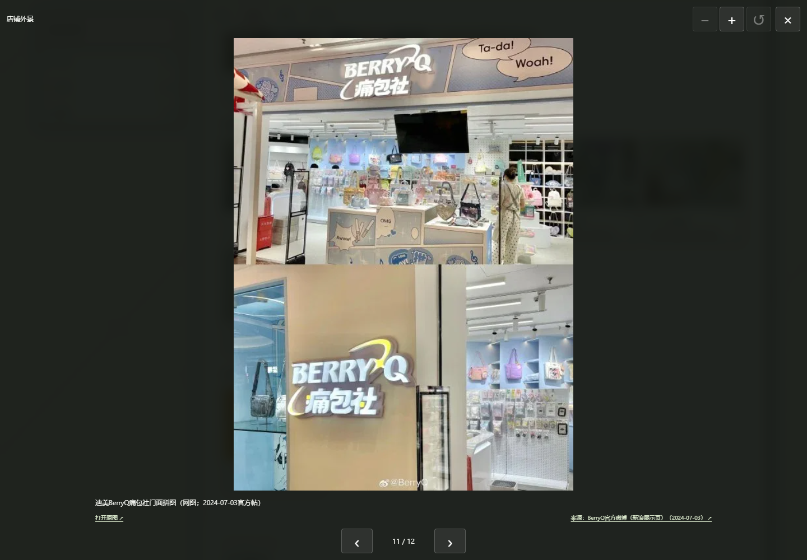
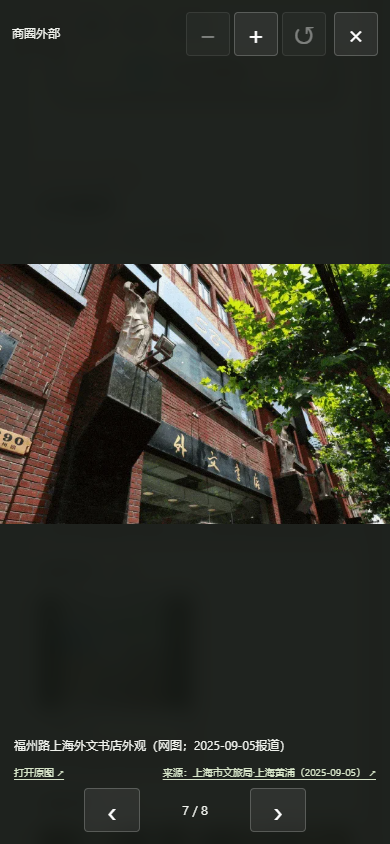
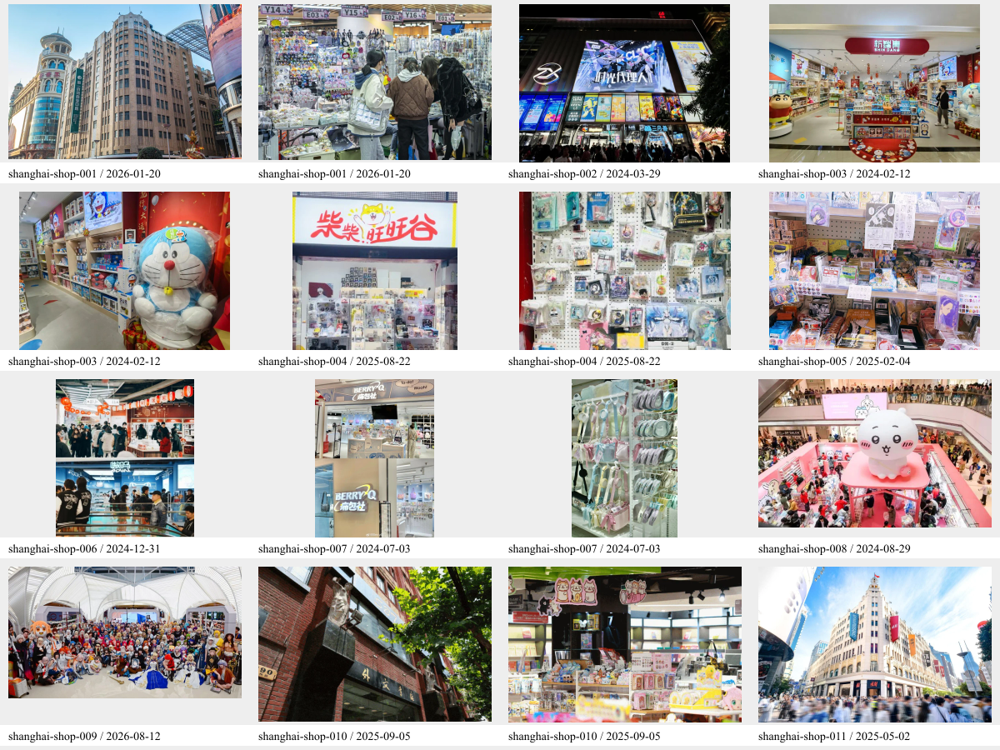
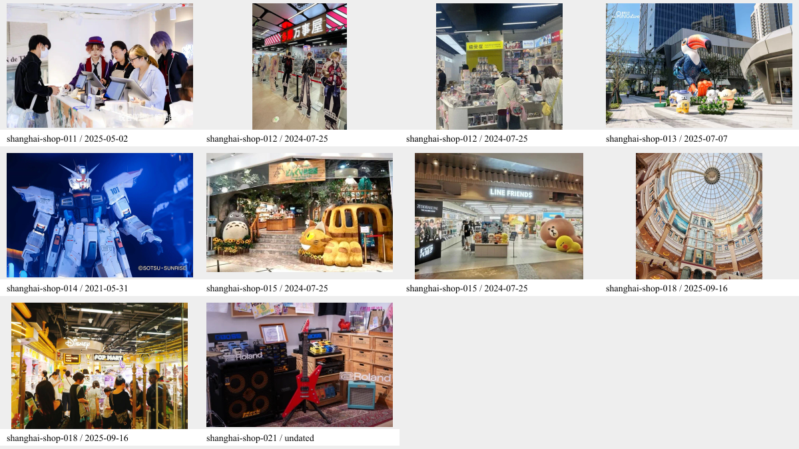

# 上海17处商圈网图补充

整理日期：2026-10-17。范围按用户确认，为 BV1uUWizfEvv 已接入的17个上海商圈；包含“少女乐队乐器店”类别下的 HIPPIHO 代表门店。

本轮新增26张网图，全部保存到 `rank/public/images/places/Shanghai/网图补充/`，配置在 `rank/src/data/places.json` 的原有图集中。沿用商圈外部、店铺外景、店铺内景、额外活动四类；保留全部原有照片与文字，不更换封面、不改变评级、排序、到访日期。新增一条批次图集更新，仅对应地点的 `updatedAt` 随图集更新至本次整理日期。

## 逐处结果

下表日期均为来源发布日期，不等同于拍摄或作者到访日期；活动时间另在图注说明。每张图片的完整图文来源、原图URL、尺寸、哈希、处理方式与具体匹配依据见 [sources.json](sources.json)。页面缩略图及大图均展示来源名称和可点击的原始图文链接。

| 商圈／稳定ID | 新增／原有素材数 | 内容与分组 | 来源 | 来源日期 |
| --- | --- | --- | --- | --- |
| 第一百货（`shanghai-shop-001`） | +2／原19 | 第一百货建筑外观 · 商圈外部；第一百货练摊现场 · 额外活动 | [人民网·金台资讯](https://k.sina.cn/article_6824573189_196c6b90502002i7la.html) | 2026-01-20 |
| 南京路百联（`shanghai-shop-002`） | +1／原15 | 南京路百联ZX创趣场夜景 · 商圈外部 | [上海市国资委·百联集团](https://www.gzw.sh.gov.cn/shgzw_zxzx_gqdt/20240329/b9562716295841249822dd7e24769952.html) | 2024-03-29 |
| 新世界城（`shanghai-shop-003`） | +2／原10 | 新世界城新鐺集门面 · 店铺外景；新世界城新鐺集店内陈列 · 店铺内景 | [上海黄浦·范煜昊](https://m.thepaper.cn/newsDetail_forward_26350360) | 2024-02-12 |
| 华盛小亭（`shanghai-shop-004`） | +2／原15 | 华盛小亭柴柴旺旺谷门面 · 店铺外景；华盛小亭谷子寄售陈列 · 店铺内景 | [新闻晨报·人民资讯](https://k.sina.cn/article_7517400647_1c0126e4705907fyds.html?from=news) | 2025-08-22 |
| 百米香榭（`shanghai-shop-005`） | +1／原16 | 百米香榭Anikigoods店内陈列 · 店铺内景 | [界面新闻·受访者供图](https://m.jiemian.com/article/12305072_microcontent.html) | 2025-02-04 |
| 五角场百联（`shanghai-shop-006`） | +1／原4 | 五角场百联ZX造趣场店铺拼图 · 店铺外景 | [上海市国资委·百联集团](https://www.gzw.sh.gov.cn/shgzw_zxzx_gqdt/20241231/5727e9ec48814426a0e5667d1391c842.html) | 2024-12-31 |
| 迪美（`shanghai-shop-007`） | +2／原10 | 迪美BerryQ痛包社门面拼图 · 店铺外景；迪美BerryQ痛包陈列 · 店铺内景 | [BerryQ官方微博](https://www.sina.cn/news/detail/5052158275750380.html) | 2024-07-03 |
| 静安大悦城（`shanghai-shop-008`） | +1／原11 | 静安大悦城Chiikawa×MINISO快闪 · 额外活动 | [上海静安区融媒体中心·受访者供图](https://www.jingan.gov.cn/rmtzx/003001/20240830/cac351a7-28ab-4b4d-b340-66f1f95f8693.html) | 2024-08-29 |
| 五角场万达广场（`shanghai-shop-009`） | +1／原8 | 五角场万达FGO嘉年华 · 额外活动 | [万达集团官网](https://www.wanda.cn/2026/2026_0812/48374.html) | 2026-08-12 |
| 外文书店（`shanghai-shop-010`） | +2／原6 | 福州路上海外文书店外观 · 商圈外部；外文书店四楼松坂书屋陈列 · 店铺内景 | [上海市文旅局·上海黄浦](https://whlyj.sh.gov.cn/gqfc/20250905/32ad6ff65a6345848f5429782d2a8959.html) | 2025-09-05 |
| 悦荟广场（`shanghai-shop-011`） | +2／原8 | 上海悦荟广场外观 · 商圈外部；悦荟恰恰谷Rejet Shop柜台 · 店铺内景 | [上海黄浦·邹嘉](https://m.thepaper.cn/newsDetail_forward_30762914) | 2025-05-02 |
| TPY中心（`shanghai-shop-012`） | +2／原7 | TPY中心多摩万事屋门面 · 店铺外景；TPY中心谷店内景 · 店铺内景 | [新浪财经·媒体滚动](https://finance.sina.com.cn/jjxw/2024-07-25/doc-incfiqva6232068.shtml) | 2024-07-25 |
| 鑫耀光环live二期（`shanghai-shop-013`） | +1／原13 | 鑫耀光环Live二期外观与巨嘴鸟装置 · 商圈外部 | [CircleME](https://www.circlemeculture.com/2025/07/07/001-16/) | 2025-07-07 |
| 金桥LaLaport（`shanghai-shop-014`） | +1／原6 | 金桥LaLaport自由高达立像 · 商圈外部 | [万代南梦宫中国官网](https://www.bandainamcochina.cn/zh-cn/news/%E3%80%8C%E5%AE%9E%E7%89%A9%E5%A4%A7%E8%87%AA%E7%94%B1%E9%AB%98%E8%BE%BE%E7%AB%8B%E5%83%8F%E6%8F%AD%E5%B9%95%E5%BC%8F%E3%80%8D%E5%8D%8E%E4%B8%BD%E5%BC%80%E5%B9%95%EF%BC%81-%E3%80%8Cgundam-seed-project/) | 2021-05-31 |
| 美罗城（`shanghai-shop-015`） | +2／原3 | 美罗城橡子共和国门面 · 店铺外景；美罗城LINE FRIENDS门面 · 店铺外景 | [新浪财经·媒体滚动](https://finance.sina.com.cn/jjxw/2024-07-25/doc-incfiqva6232068.shtml) | 2024-07-25 |
| 环球港（`shanghai-shop-018`） | +2／原11 | 上海环球港穹顶中庭 · 商圈外部；上海环球港潮玩店铺 · 店铺外景 | [上海普陀](https://www.shpt.gov.cn/bm-ms/20250916/963621.html) | 2025-09-16 |
| 少女乐队乐器店（`shanghai-shop-021`） | +1／原5 | HIPPIHO乐器陈列 · 店铺内景 | [Roland中国官网](https://www.roland-china.com/dealer/dealer_list2/shanghai/) | 页面未标日期 |

## 来源判断与维护边界

- 实际读取了来源正文并查看下载配图，按地址、正文所属段落、招牌及图注核对；不是只依据搜索缩略图匹配。南京路创趣场与五角场造趣场、TPY与美罗城、环球港与真如环宇城分别匹配，未混用同名或相邻商圈图片。
- 历史门店照片仅表示报道当时的门面或陈列，不保证当前库存、布局或营业状态。静安大悦城2024年Chiikawa快闪、五角场万达2026-08-08 FGO嘉年华、金桥LaLaport2021年揭幕时期照片已在图注标出历史时间，不把旧优惠和活动改写成当前信息。
- 静安大悦城来源页目录为2024-08-30，但可见发稿时间为2024-08-29，采用后者。Roland经销商页未标发布日期，明确留空；2026-10-17仅为本次读取日期。
- HIPPIHO的乐器图来自Roland官网上海经销商“上海雅哩文化传播有限公司”项，明确关联长寿路155号巴黎春天三楼HIPPIHO；仅代表该门店，不泛化到此类别下其他乐器店。
- 五角场造趣场外观候选与原有“ 五角场百联.jpeg ”是同一照片的不同裁幅，未重复添加，保留现有较高分辨率照片。百米香榭采访GIF未采用，改用原采访中图注明确的Anikigoods静态陈列图。未采用表情包、搜索拼贴或缺少地点依据的商品图。
- 所有新增素材等比例缩小至最长边不超过1600px并编码为WebP，保留完整画面、署名及水印，不放大、不裁切、不重绘。26张合计约3.07 MiB；继续使用既有构建流程生成缩略图。图片归各原作者或权利人所有，来源链接不表示获得额外授权。
- 遵循 [店铺一览固定维护规则](../../shop-directory-rules.md)：本轮不新增店铺、不变更营业分类、账号、主营或来源，不更新任何店单 `checkedAt`。网图不用于确认当前营业；所有旧来源与隐藏／折叠展示逻辑保留。

## 验证

- 数据校验与最终构建通过：29个地点、22条更新。48项已有单元测试通过。
- 将修改前数据与本次数据逐项比较：全部原有图集条目完整保留，除图集及其更新时间外，地点字段保持不变；`shop-directories.json`字节内容一致。
- Edge桌面浏览器逐一进入17个页面：新增图可加载，来源名称与链接对应，大图能打开和关闭；无新增图片404，未触发B站资源请求。去重后复查五角场百联为原4张加1张，重复候选不再出现。
- 390px窄屏检查外文书店大图和来源布局，无横向溢出，关闭可用。真实手机设备未实测。
- 按维护规则复查既有6份店单共136家：总数保留，闭店不进入营业中区，营业中隐藏营业／位置及主营依据列表；“展开更多”初始关闭、点击可展开，折叠区全部原始来源链接与数据一致。
- 没有待确认的图片地点匹配；未额外复核这些历史照片对应商户的当前营业、活动或库存。未提交、推送或发布。

## 选图联系表

